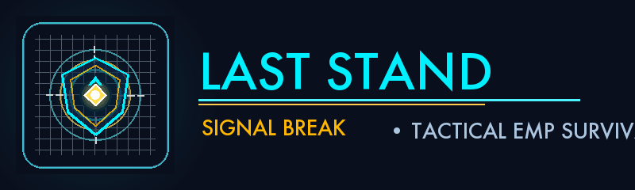

# Last Stand: Signal Break

  

  <strong>GDG TECH Recruitment Task Submission — 2D Game Development Track</strong> 
  <em>Tactical Top-Down Sci-Fi Survival Arcade Game with EMP Shockwave Disruption Mechanics</em>

  <a href="https://sarveshs1407.github.io/LastStand-CC/"><strong>🌐 Play Online (Mobile & Desktop PWA)</strong></a> •
  <a href="https://github.com/SarveshS1407/LastStand-CC/releases/tag/v1.0.0"><strong>📦 Standalone macOS Build</strong></a> •
  <a href="#3-mobile-controls--pwa-installation"><strong>📱 Install to Phone</strong></a>

---

## 🎮 Playable Web URL & Mobile Launch

The game is deployed as an **Installable Progressive Web App (PWA)** accessible directly in mobile and desktop browsers over HTTPS:

👉 **[https://sarveshs1407.github.io/LastStand-CC/](https://sarveshs1407.github.io/LastStand-CC/)**

- **Desktop:** Open the link to play in any modern browser using keyboard controls.
- **Mobile Phones (Android & iPhone):** Full responsive touch controls with floating analog thumbstick, tactical EMP Pulse button, and home-screen app installation.

---

## 1. Overview & Core Concept

**Last Stand: Signal Break** is a tactical top-down sci-fi survival arcade game set inside an isolated, high-security server core. The facility's automated defense network deploys patrolling drones across the sector. When an operative is detected, the network triggers persistent pursuit.

As the operative, your objective is to infiltrate the sector, collect **12 Energy Cores** across **4 escalating threat waves**, and survive. Rather than standard projectile shooting, your primary defensive weapon is the **Disruption Pulse**—an expanding circular EMP shockwave that stuns hostiles, halts their pursuit, and disables contact damage.

---

## 2. Core Mechanics & Features

### 2.1 The Disruption Pulse & EMP Overcharge (Spacebar / On-Screen Button)
- **Standard Pulse:** Expands outward from the operative up to a **175-pixel radius**, stunning all hostiles within the blast wave for **3.0 seconds**.
- **EMP Overcharge:** Collecting a golden Overcharge Cell empowers your next pulse to expand to a massive **280-pixel radius**, stunning enemies for **4.2 seconds** with golden visual arcs!
- **Resource Management:** Firing costs **25 Energy Units** (out of 100 max). Firing is disabled when energy is depleted, preventing mindless spam.
- **Cooldown Constraint:** A 0.8-second safety cooldown prevents accidental double-activation.
- **Recharge Mechanics:** Energy recharges via Energy Cores (+30 Energy), Overcharge Cells (100% full refill), or passive trickle (+1.8/s).

### 2.2 Enemy Drone Archetypes & 4-State AI (FSM)
Security drones run on a robust 4-state Finite State Machine (`PATROL` $\rightarrow$ `CHASE` $\rightarrow$ `STUNNED` $\rightarrow$ `RETURN`):
1. **Scout Drone (Amber):** Fast reconnaissance unit (105 px/s patrol, 165 px/s chase). Rapid corridor sweeper.
2. **Heavy Enforcer Drone (Violet):** Armored security unit. Deals **2 shield damage** on contact and has a reinforced chassis that recovers from EMP stuns 35% faster.
3. **Hunter Drone (Crimson):** Relentless tracker with elevated detection radius (240 px) and aggressive pursuit speed (185 px/s).

### 2.3 Wave Progression & Objectives
- **Wave 1: INFILTRATION (0 - 3 Cores):** Sector defenses in routine patrol mode. Low threat.
- **Wave 2: DEFENSE GRID ALERT (4 - 6 Cores):** Sensor grid activated. Drones increase patrol alertness.
- **Wave 3: SECTOR LOCKDOWN (7 - 9 Cores):** Heavy Enforcers and Hunters actively sweep inner choke points.
- **Wave 4: EXTRACTION OVERRIDE (10 - 12 Cores):** Final cores secured. Extraction transport signals incoming.

### 2.4 Pickups & Power-Ups
- **Energy Core (+100 Score, +30 Energy):** Primary objective item required for uplink.
- **Shield Repair Kit (+75 Score, +1 Shield):** Restores lost operative shields (up to 3 max).
- **EMP Overcharge Cell (+150 Score, 100% Energy, Super-Pulse):** Empowers next pulse with 280px radius.

### 2.5 Multi-Disrupt Combo Scoring & High Scores
- Stunning multiple drones simultaneously with a single pulse triggers **MULTI-DISRUPT** combo multipliers (+50 bonus points per additional drone!).
- **High Score Persistence:** Best score and survival time are automatically saved locally (`user://records.cfg` / IndexedDB on Web).

---

## 3. Mobile Controls & PWA Installation

### 3.1 Intuitive Mobile Touch Interface
When launched on phones or touch devices, the game automatically surfaces an on-screen tactical HUD:
- **Floating Virtual Thumbstick (Bottom-Left):** Smooth 360° analog thumbstick that tracks your finger, providing precise 8-way directional navigation.
- **Tactile EMP Pulse Button (Bottom-Right):** Large circular action button with live status feedback (cyan when ready, dim on cooldown, and radiant pulsing gold when EMP Overcharge is active).
- **Tactical Pause Button (Top-Right):** Instant in-game pause and volume/settings access.
- **Tap-to-Restart:** Game Over and Victory screens can be dismissed with a single screen tap.

### 3.2 How to Install on Android
1. Open **[https://sarveshs1407.github.io/LastStand-CC/](https://sarveshs1407.github.io/LastStand-CC/)** in **Google Chrome**.
2. Tap the **"📲 INSTALL APP"** button at the top-right, or tap Chrome's menu (`⋮`) and select **"Add to Home screen"** or **"Install app"**.
3. Confirm the prompt.
4. **Last Stand** will now appear on your phone's home screen with its custom cyber shield app icon and launch in full-screen standalone mode!

### 3.3 How to Install on iPhone (iOS Safari)
1. Open **[https://sarveshs1407.github.io/LastStand-CC/](https://sarveshs1407.github.io/LastStand-CC/)** in **Safari**.
2. Tap the **Share** button (the square with an arrow pointing upward `⎋`) at the bottom of the screen.
3. Scroll down and tap **"Add to Home Screen"** (`⊞`).
4. Tap **"Add"** in the upper right.
5. Launch **LastStand** directly from your home screen for a seamless, borderless full-screen experience!

---

## 4. Controls Matrix

| Action | Mobile / Touch | Desktop Keyboard | Alternate Input |
| :--- | :--- | :--- | :--- |
| **Move Up / Down / Left / Right** | Virtual Thumbstick (Left) | `W` / `A` / `S` / `D` | `Arrow Keys` |
| **Trigger Disruption Pulse** | Tap "EMP PULSE" Button (Right) | `Spacebar` | `Enter` / `UI Select` |
| **Pause & Settings Dialog** | Tap `❚❚` Icon (Top Right) | `Escape` | `P` |
| **Toggle Fullscreen** | In Settings Menu | `F11` | Settings Dialog |
| **Quick Restart** | Tap Screen Anywhere | `R` | Spacebar / Enter |

---

## 5. Technology Stack & Deployment Architecture

- **Game Engine:** Godot Engine 4.7.2 (Single-Threaded GL Compatibility Renderer)
- **Programming Language:** GDScript
- **Web Export Target:** WebAssembly (Wasm) + WebGL 2 / HTML5
- **Single-Threaded Web Advantage:** Does not require SharedArrayBuffer or cross-origin isolation (COOP/COEP) headers, ensuring seamless compatibility across mobile Safari (iOS), Chrome (Android), and desktop browsers.
- **Branding Assets:** Custom SVG vector logos, 512×512 master icons, 192×192 mobile icons, 512×512 maskable adaptive icons, 180×180 Apple touch icons, and favicons.
- **PWA Service Worker:** Stale-while-revalidate / cache-first service worker (`sw.js`) that pre-caches game binaries for lightning-fast loads and offline readiness, with automated update detection.
- **Hosting & CI/CD Pipeline:** Hosted on **GitHub Pages** via GitHub Actions (`.github/workflows/deploy.yml`), deploying automatically on every commit to `main`.

---

## 6. Automatic Updates & Future Development

1. **GitHub to Hosting Pipeline:**
   Every push to the `main` branch automatically triggers the GitHub Actions deployment workflow, publishing the updated game to GitHub Pages within seconds.
2. **Client Update Detection:**
   The Service Worker checks for new production versions on network startup. When a newer build is detected, a glowing notification banner appears (*"⚡ NEW UPDATE AVAILABLE • TAP TO RELOAD"*).
3. **Save Data Preservation:**
   Game records (high score and best survival time) are stored separately in browser IndexedDB (`user://records.cfg`) and persist across updates without being wiped.

---

## 7. Automated QA Testing Report

An automated test suite containing 31 comprehensive assertions was executed in Godot 4.7.2 headless mode (`tests/test_game.gd`).

### Results: `31 PASSED, 0 FAILED`

| Category | Checks Performed | Result |
| :--- | :--- | :--- |
| **1600×900 Architecture** | Viewport resolution, camera centering, 12 cores, 4 drones, player spawn. | **PASS** |
| **Drone Archetypes** | Scout, Heavy Enforcer (2 damage), Hunter (185 px/s chase), Enforcer stun reduction. | **PASS** |
| **Pulse & Overcharge** | Energy deduction (25 EP), Overcharge EMP status, 100% refill, super-pulse consumption. | **PASS** |
| **Pickups** | Shield repair (+1 HP), Overcharge cell pickup and activation. | **PASS** |
| **Wave Progression** | Wave 1 (Infiltration) $\rightarrow$ Wave 2 (Alert) $\rightarrow$ Wave 3 (Lockdown) $\rightarrow$ Wave 4 (Override). | **PASS** |
| **Combo Scoring** | Single drone (+25 score), Multi-drone stun combo calculation (+175 score). | **PASS** |
| **End States & Records** | 12 cores victory transition, overlay display, high-score file persistence. | **PASS** |
| **Mobile Touch Controls** | TouchControls scene present, SettingsManager helper, Player analog touch vector. | **PASS** |

---

## 8. How to Run Locally in Godot 4 Editor

1. Open **Godot 4.7.2** on your machine.
2. Select the `last-stand` project from the project list.
3. Press **F5** (or click the **Play** button in the upper right).
4. The game opens in a large, centered 1600×900 window with the Mission Briefing.
